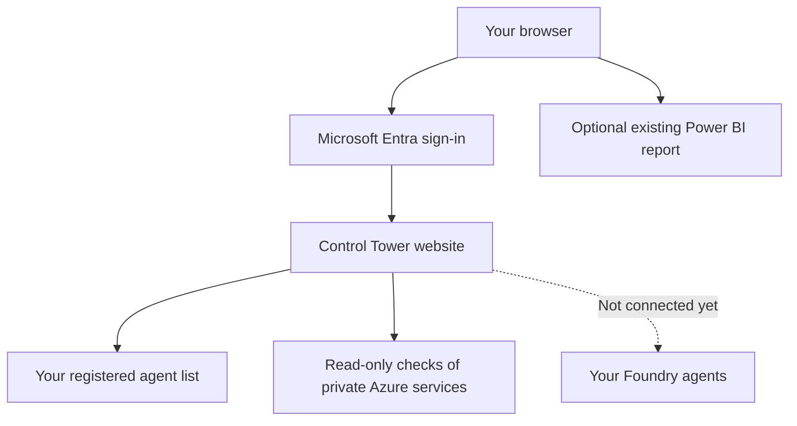

# What this foundation does

**For:** customers who want to understand the package before installing it.

This gives you the starting pieces of an AI Control Tower in **non-production**.
It does **not** give you a working agent kill switch yet.

## What you can show

| Available now | Not connected yet |
| --- | --- |
| A website with Microsoft Entra sign-in | Stopping or resuming a real agent |
| A list of your own registered agents | Automatic discovery or live agent status |
| Checks that the website can reach its Azure services | Automatic collection of agent metrics |
| Your existing Power BI report, if you add it | A new Power BI report or Fabric pipeline |

The customer agent list starts empty. Missing metrics are shown as unavailable. An optional **Illustrative preview** shows fictitious, clearly labelled mock-ups on all four screens without modifying customer inventory. Its pause walkthrough is a local simulation only; runtime controls remain disabled.
Adding an agent to the list does not connect to it. Its runtime status stays **unknown**.

## How the pieces fit

Without the diagram: **sign in -> view your agent list -> check foundation connections**.
Your Power BI report keeps its own access permissions.

## What your team needs to do

1. **Platform owner:** approve the Azure environment, costs and network design.
2. **Identity owner:** set up sign-in and assign Viewer or Operator access.
3. **Agent owner:** provide approved non-production agent details.
4. **Deployment owner:** install the package and run the checks.

The default website is **public but sign-in protected**. Private connections to its
data services do not make the website private. If your policy requires a private
website, your platform team must adapt the templates first.

The templates create separate resources. They do not automatically reuse your
existing services or change your Foundry agents.

## When is the foundation ready to demo?

- Approved users can sign in and see only your registered agents.
- Azure connection checks pass.
- Any displayed report is your authorised customer report.
- Stop and resume remain disabled, including for Operators.

**A successful demo proves the foundation works. It does not prove an agent can be stopped.**

## Choose your next step

- Try it locally: [short README](../README.md).
- Install in Azure: [deployment guide](DEPLOYMENT-GUIDE.md).
- Check the installation: [validation checklist](NONPROD-VALIDATION.md).
- Plan a real kill switch: [Foundry onboarding](FOUNDRY-ONBOARDING.md).
